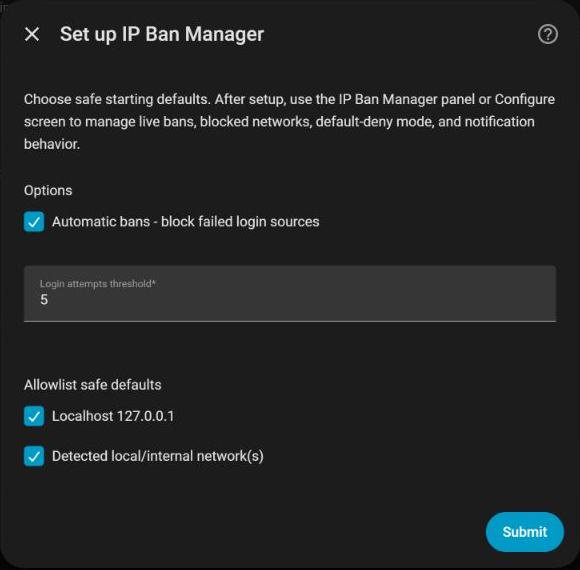
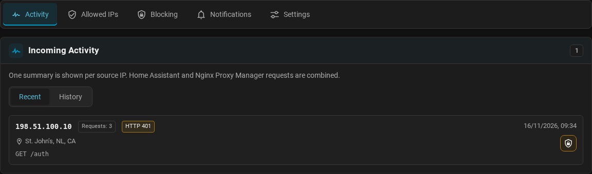
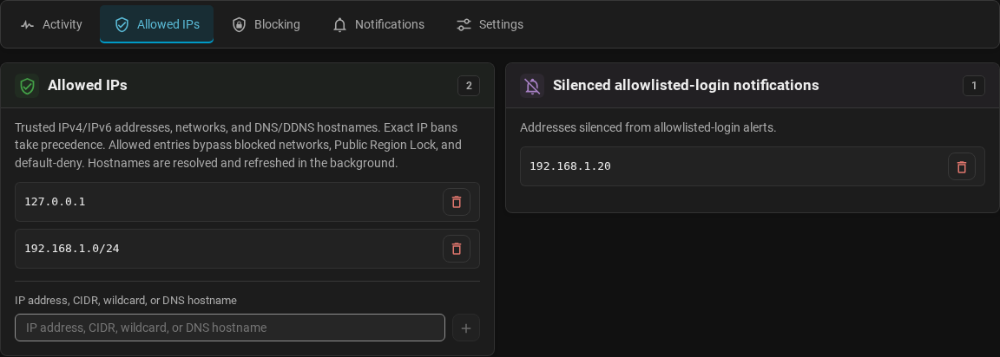
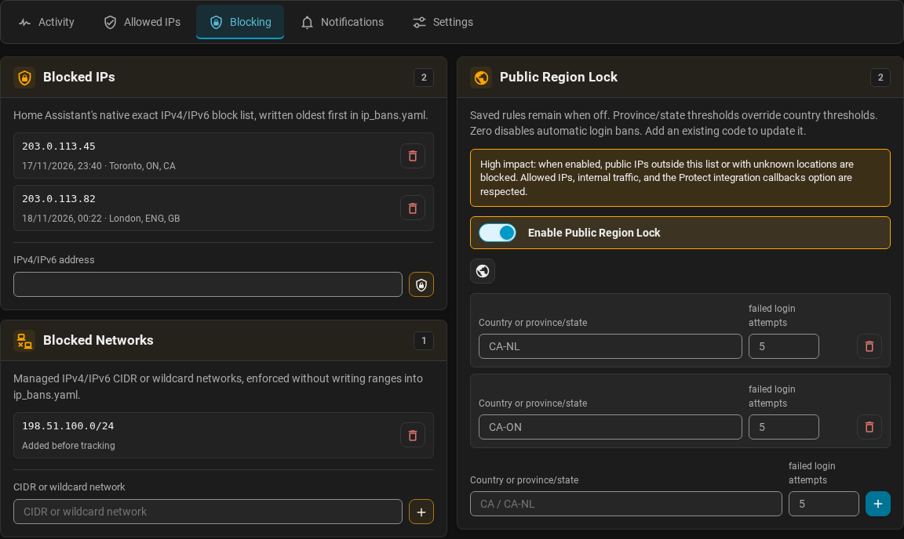
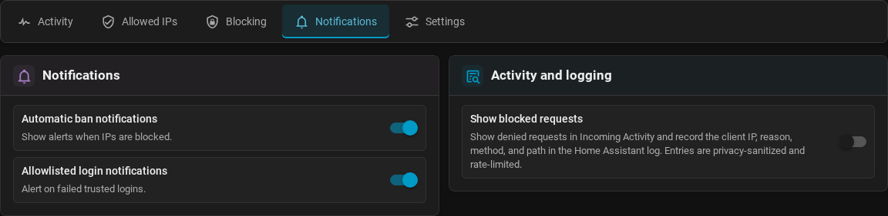
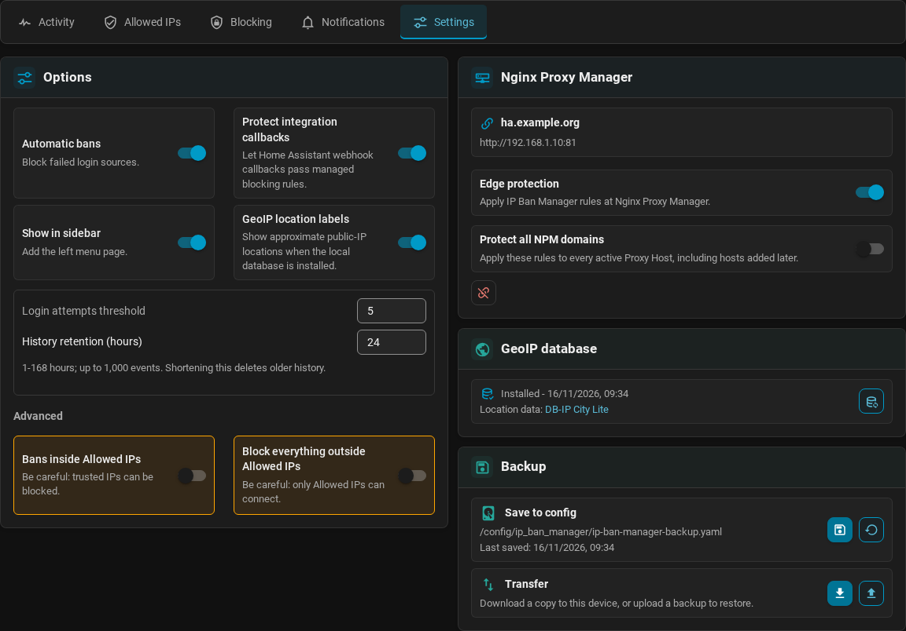

<div align="center">

<h1>
  
  IP Ban Manager
</h1>

### Live IP ban and allowlist management for Home Assistant

[](https://github.com/hacs/integration)
[](https://www.home-assistant.io/)
[](https://github.com/Wheemer/ip-ban-manager/releases/latest)
[](https://github.com/Wheemer/ip-ban-manager/releases)
[](https://github.com/Wheemer/ip-ban-manager/blob/main/LICENSE)

[Install](#install) • [Configure](#configure) • [Live Panel](#live-panel) • [Backup And Restore](#backup-and-restore) • [Translations](docs/translations.md) • [Release Summary](RELEASES.md) • [Changelog](CHANGELOG.md)

</div>

Originally created by [palfrey](https://github.com/palfrey). This fork builds on that allowlist work with a live Home Assistant IP ban and allowlist manager UI.

> [!WARNING]
> This integration uses Home Assistant's internal HTTP ban interfaces because there is no public API for these controls. Review your Allowed IPs before enabling restrictive settings, and keep the [emergency-disable instructions](#emergency-disable) accessible.

IP Ban Manager provides a live interface for Home Assistant's built-in [IP filtering and banning](https://www.home-assistant.io/integrations/http/#ip-filtering-and-banning), with allowlists, network blocks, region restrictions, notifications, and automation support.

Requires Home Assistant `2026.4.0` or newer. Designed for Home Assistant OS, Container, and existing Core and Supervised installations. Older Home Assistant installations must stay on an earlier compatible IP Ban Manager release.

## What It Does

- Manage exact IP bans, blocked networks, and trusted IPv4/IPv6 addresses or DNS/DDNS hostnames.
- Restrict public access by country or province/state using an optional local GeoIP database.
- Review incoming activity, control notifications, and automate responses with services and events.
- Optionally mirror protection to NGINX Proxy Manager before requests reach Home Assistant.
- Save and restore your configuration using readable YAML backups.

## Install

[](https://my.home-assistant.io/redirect/hacs_repository/?owner=Wheemer&repository=ip-ban-manager&category=integration)

1. Add `https://github.com/Wheemer/ip-ban-manager` to HACS as an **Integration**, then install it.
2. Restart Home Assistant Core after installing or updating.
3. Make sure Home Assistant's built-in **IP banning** is enabled; see [HTTP setup](docs/configuration.md#configure) for your HA version.
4. Open **Settings > Devices & services > Add integration > IP Ban Manager**.
5. Review your Allowed IPs before enabling restrictive settings.

Open the panel from the integration's **Configure** button. Adding it to the sidebar is optional.

## Live Panel

| Tab | Controls |
| --- | --- |
| Activity | Incoming activity, Recent requests, and local History. |
| Allowed IPs | Trusted addresses, networks, DNS hostnames, and silenced-login addresses. |
| Blocking | Exact IP bans, blocked networks, and Public Region Lock. |
| Notifications | Ban alerts, allowlisted-login alerts, and optional blocked-request logging. |
| Settings | Automatic bans, NPM, GeoIP, history retention, and backups. |

Switches save immediately. Valid login-attempt and history-retention edits save
when you leave the field or press Enter. Region rows have their own **Apply**
controls. Toasts confirm the saved setting; risky changes still need confirmation.

Desktop actions use compact icons with tooltips; touch devices retain larger
labeled controls. Activity updates without refreshing the whole page.

## Screenshots

<table>
  <tr>
    <td width="50%" valign="top" align="center">
      <a href="https://raw.githubusercontent.com/Wheemer/ip-ban-manager/main/docs/images/setup-flow.png"></a>
    </td>
    <td width="50%" valign="top">
      <a href="https://raw.githubusercontent.com/Wheemer/ip-ban-manager/main/docs/images/panel-activity.png"></a>
    </td>
  </tr>
  <tr>
    <td width="50%" valign="top">
      <a href="https://raw.githubusercontent.com/Wheemer/ip-ban-manager/main/docs/images/panel-allowed.png"></a>
    </td>
    <td width="50%" valign="top">
      <a href="https://raw.githubusercontent.com/Wheemer/ip-ban-manager/main/docs/images/panel-blocking.png"></a>
    </td>
  </tr>
  <tr>
    <td width="50%" valign="top">
      <a href="https://raw.githubusercontent.com/Wheemer/ip-ban-manager/main/docs/images/panel-notifications.png"></a>
    </td>
    <td width="50%" valign="top">
      <a href="https://raw.githubusercontent.com/Wheemer/ip-ban-manager/main/docs/images/panel-settings.png"></a>
    </td>
  </tr>
</table>

## Configure

Start with a suitable allowlist, then enable only the restrictions you need.
Home Assistant's own exact interface addresses are protected internally; the
safe-default option adds detected local/internal networks as visible, editable
Allowed IPs entries.

| Topic | Details |
| --- | --- |
| [Allowed IPs](docs/configuration.md#allowed-ips) | IPs, CIDR, wildcard and DNS/DDNS entries; precedence and refresh behavior. |
| [Blocked IPs](docs/configuration.md#blocked-ips) and [networks](docs/configuration.md#blocked-networks) | Native exact bans versus managed network restrictions. |
| [Public Region Lock](docs/configuration.md#public-region-lock) | Region lists, login thresholds, and GeoIP limitations. |
| [NGINX Proxy Manager](docs/configuration.md#nginx-proxy-manager-edge-protection) | Connection setup, host matching, all-domain protection, and recovery. |
| [Incoming activity](docs/configuration.md#incoming-activity) | History limits, optional blocked requests, and privacy. |
| [Safety checks](docs/configuration.md#safety-checks) | Local protection, callback exemptions, and confirmations. |

**Protect integration callbacks** is on by default. Supported OAuth/webhook routes
bypass managed network and regional restrictions, but exact IP bans and Home
Assistant's authentication still apply. No safeguard covers every network or proxy.

## GeoIP Labels

Download the optional **DB-IP City Lite** database in Settings, then enable
location labels. Public-IP lookups use this local database and are approximate.
Private and loopback addresses are not geolocated.

Home-region shortcuts use HA's configured location; detecting its province/state
uses a separate online lookup. Reverse DNS is separate too.
See [GeoIP and lookup services](docs/configuration.md#geoip-labels).

## Backup And Restore

IP Ban Manager loads its live settings from the private
`/config/ip_ban_manager/settings.json` file, separate from manual backups.
Upgrading creates the file from existing settings. Reinstalling uses the same
file and posts a Home Assistant notification if saved restrictions are active.
The file may contain NPM credentials; keep it private. Home Assistant's native
ban list is stored separately.

In **Settings > Backup**, save/restore a file in your HA configuration folder or
download/upload one through the browser. The default file is:

```text
/config/ip_ban_manager/ip-ban-manager-backup.yaml
```

Backups include settings, exact bans, and NPM credentials when configured, but
not the GeoIP database or activity history. **Keep them private.**
See [backup and restore safeguards](docs/configuration.md#backup-and-restore).

## Emergency Disable

If IP Ban Manager locks you out, use file access to create this empty file, then
restart Home Assistant:

```text
/config/ip_ban_manager.disabled
```

Alternatively, add this to `configuration.yaml` and restart:

```yaml
ip_ban_manager: disabled
```

> [!IMPORTANT]
> This disables IP Ban Manager, not HA's native exact bans or rules already
> written to NPM. Those remain in place. See [recovery details](docs/configuration.md#emergency-disable).

## Automation Events

Use the mobile notification blueprint, or write your own automation:

[](https://my.home-assistant.io/redirect/blueprint_import/?blueprint_url=https%3A%2F%2Fraw.githubusercontent.com%2FWheemer%2Fip-ban-manager%2Fmain%2Fblueprints%2Fautomation%2Fip_ban_manager%2Fip_ban_manager_notifications.yaml)

- [Events and example trigger](docs/configuration.md#automation-events)
- [Services and required fields](docs/configuration.md#services)
- [Diagnostic sensors and permissions](docs/configuration.md#diagnostic-sensors)

## Documentation And Support

- [Full configuration and reference guide](docs/configuration.md)
- [Translations](docs/translations.md)
- [Upgrade and legacy-install notes](docs/configuration.md#notes-for-existing-users)
- [Release summary](RELEASES.md) and [full changelog](CHANGELOG.md)
- [Report a problem or request a feature](https://github.com/Wheemer/ip-ban-manager/issues)
